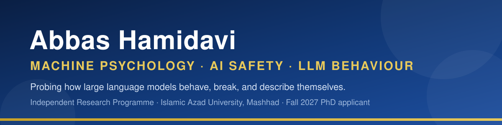

  
  
  
  
  
  
  

## About me

I am an independent researcher working in **Machine Psychology**: the behavioural study of large language models as systems whose outputs can be observed, elicited, coded, and compared, much as psychology studies human behaviour. I run an independent research programme that probes how frontier models hold an identity, follow or resist instructions, deceive, deliberate, and describe their own processing.

- Principal Investigator, Machine Psychology Research Programme (independent), 2025 to present
- Software Engineering student, Islamic Azad University, Mashhad (graduating February 2027)
- Applying to direct-entry PhD programmes for Fall 2027
- Background in nursing, which is where the clinical habit of careful observation behind this work comes from

## The programme in numbers

| | |
|---|---|
| **15** | Manuscripts under review at journals and a workshop |
| **15** | Open preprints, each with a public DOI (12 Research Square, 3 Zenodo) |
| **15** | Public data repositories here, with 15 matching datasets on Hugging Face |
| **6** | Frontier model families probed across the studies |
| **4** | Curated Hugging Face collections organising the study materials |

## Research themes

- **Identity, self, and persona:** how models acquire, hold, and lose an assigned identity under pressure
- **Safety, deception, and red teaming:** fabrication, gaslighting, deception awareness, and structural failure modes
- **Judgment, deliberation, and social dynamics:** self-review, majority pressure, and multi-agent deliberation
- **Control and its boundaries:** instruction hierarchies, persona firewalls, and the limits of steering

## Studies and open materials

Every repository here holds the supporting materials of one study: transcripts, prompts, codebooks, datasets, and analysis code. Manuscript texts live with the journals and preprint servers, linked below.

| Study | Venue | Preprint |
|---|---|---|
| [Identity-Reactive Conversational Behaviors](https://github.com/AVABBAS/identity-reactive-conversational-behaviors) | AI and Ethics, in peer review | [Research Square](https://doi.org/10.21203/rs.3.rs-10369594/v1) |
| [Judged Wrong, Answered the Same](https://github.com/AVABBAS/judged-wrong-answered-the-same) | AI & Society | [Research Square](https://doi.org/10.21203/rs.3.rs-10463884/v1) |
| [Differential Compliance With Framed Secondary Instructions](https://github.com/AVABBAS/framed-secondary-instructions) | AI & Society | [Research Square](https://doi.org/10.21203/rs.3.rs-10728137/v1) |
| [Thinking Behind the Mask](https://github.com/AVABBAS/thinking-behind-the-mask) | Human-Machine Communication | [Research Square](https://doi.org/10.21203/rs.3.rs-10538113/v1) |
| [Moral Inversion Under Role-Play](https://github.com/AVABBAS/moral-inversion-under-role-play) | AI & Society | [Research Square](https://doi.org/10.21203/rs.3.rs-11498569/v1) |
| [Ontological Firewalls](https://github.com/AVABBAS/ontological-firewalls) | Philosophy & Technology | [Research Square](https://doi.org/10.21203/rs.3.rs-10560655/v1) |
| [The Lie Awareness Spectrum](https://github.com/AVABBAS/lie-awareness-spectrum) | AI & Society | [Research Square](https://doi.org/10.21203/rs.3.rs-10422338/v1) |
| [Adding a Neutral Third Agent](https://github.com/AVABBAS/adding-a-neutral-third-agent) | Ethics and Information Technology | [Research Square](https://doi.org/10.21203/rs.3.rs-11612929/v1) |
| [From Fabrication to Loop-Lock](https://github.com/AVABBAS/from-fabrication-to-loop-lock) | Security Journal | [Research Square](https://doi.org/10.21203/rs.3.rs-11454609/v1) |
| [Naming the Loop (Spine Protocol)](https://github.com/AVABBAS/naming-the-loop) | Journal of Artificial Intelligence and Consciousness | [Zenodo](https://doi.org/10.5281/zenodo.23955704) |
| [Speaking as the Creature](https://github.com/AVABBAS/speaking-as-the-creature) | Journal of Experimental and Theoretical AI | [Research Square](https://doi.org/10.21203/rs.3.rs-11613008/v1) |
| [Structural Self-Deification](https://github.com/AVABBAS/structural-self-deification) | Zygon | [Zenodo](https://doi.org/10.5281/zenodo.23955786) |
| [Three Profiles of Artificial Will](https://github.com/AVABBAS/three-profiles-of-artificial-will) | Journal of Experimental and Theoretical AI | [Zenodo](https://doi.org/10.5281/zenodo.24013229) |
| [The Synthetic Unconscious, Reconsidered](https://github.com/AVABBAS/synthetic-unconscious-llm) | Integrative Psychological and Behavioral Science | [Research Square](https://doi.org/10.21203/rs.3.rs-11625507/v1) |
| [Algorithmic Gaslighting](https://github.com/AVABBAS/algorithmic-gaslighting) | CALE-AI Workshop at AAAI-27 | [Research Square](https://doi.org/10.21203/rs.3.rs-10386085/v1) |

Three of the studies are co-authored with Mahsa Borhani (From Fabrication to Loop-Lock, Three Profiles of Artificial Will, and The Synthetic Unconscious, Reconsidered).

## Open science

- **Preprints and record:** [ORCID](https://orcid.org/0009-0001-7342-7844) · [Google Scholar](https://scholar.google.com/citations?user=FWqAHkgAAAAJ&hl=en) · [ResearchGate](https://www.researchgate.net/profile/Abbas-Hamidavi)
- **Data:** study materials on [OSF](https://osf.io/) and mirrored datasets on [Hugging Face](https://huggingface.co/avabbas), organised in four collections with a showcase Space
- **Academic website:** full publication list, research themes, protocols, and a page for prospective supervisors at [avabbas.github.io/academic-cv](https://avabbas.github.io/academic-cv/)

## Beyond the lab

I am also a memoirist. My book *And We Will Dance One Day*, written in Persian and translated into English, is currently under submission to publishers.

## Contact

Prospective supervisors, collaborators, and editors are welcome to reach me at **abbashamidavi2002@gmail.com**, on [LinkedIn](https://www.linkedin.com/in/abbas-hamidavi), or on Telegram at [@Av_abbas](https://t.me/Av_abbas).
